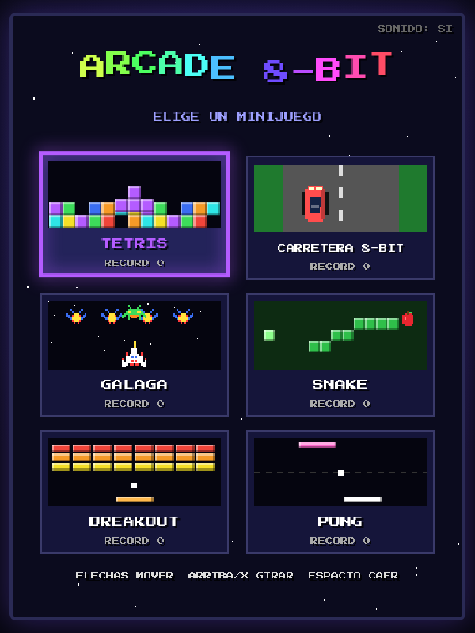
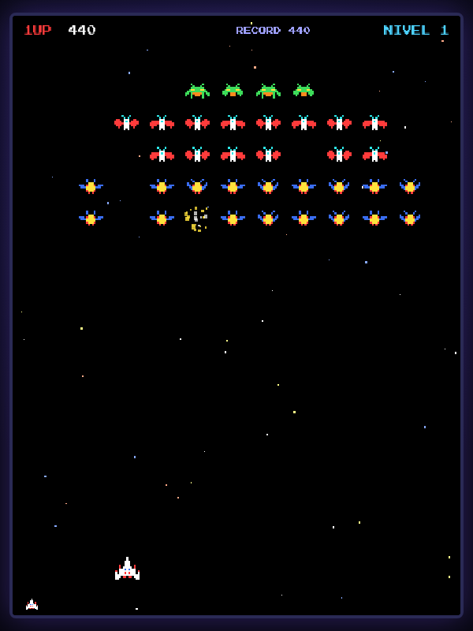
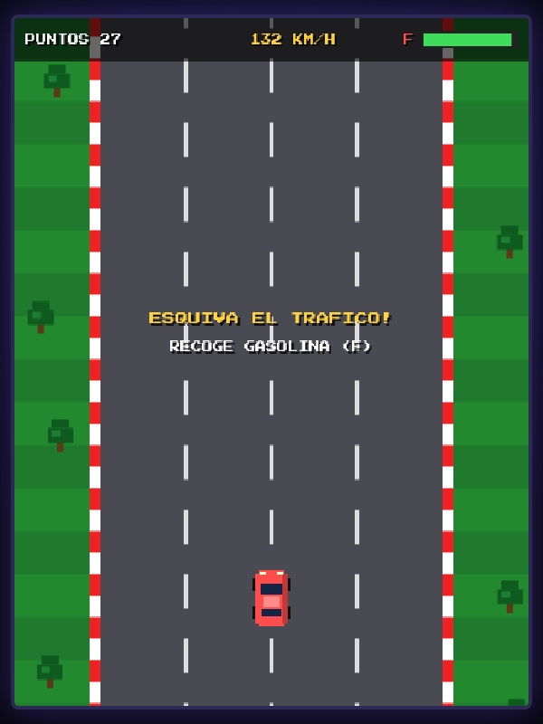

# 🕹️ Arcade 8-Bit

Una máquina arcade retro en el navegador con **un menú de 6 minijuegos** estilo 8-bit:

| Juego | Descripción |
|-------|-------------|
| 🧱 **Tetris** | Las 7 piezas clásicas, pieza fantasma, rotación con *wall kicks*, niveles que aceleran la caída. |
| 🚗 **Carretera 8-Bit** | Carreras con vista desde arriba: esquiva el tráfico, acelera, frena y recoge gasolina antes de quedarte vacío. |
| 👾 **Galaga** | Formación de abejas, mariposas y jefes (2 golpes) que se lanzan en picada y disparan. Oleadas cada vez más rápidas. |
| 🐍 **Snake** | Come manzanas, crece y no choques. Cada 5 manzanas aparece una estrella de bonus. |
| 🏓 **Breakout** | Rompe todos los ladrillos; los plateados necesitan dos golpes. Cada nivel cambia el patrón. |
| 🎾 **Pong** | Contra la CPU, gana el primero en llegar a 7 puntos. |

Incluye sonido 8-bit generado en tiempo real (Web Audio), récords guardados en el navegador, pausa, y **controles táctiles** automáticos en celulares y tabletas.



<p>
  
  
</p>

---

## 🛠️ Tecnologías

- **HTML5 Canvas** para el dibujo (resolución interna 480×640, escalado con píxeles nítidos).
- **JavaScript puro (ES2017+)**, sin frameworks ni dependencias.
- **Web Audio API** para los efectos de sonido (no hay archivos de audio).
- **localStorage** para los récords.
- Fuente pixel [Press Start 2P](https://fonts.google.com/specimen/Press+Start+2P) incluida en `assets/fonts` (licencia SIL OFL), así que funciona **sin conexión a internet**.

---

## 📦 Instalación

### Requisitos

- Un navegador moderno: Chrome, Edge, Firefox o Safari (versiones recientes).
- [Git](https://git-scm.com/downloads) para clonar el repositorio (o descarga el ZIP desde GitHub).
- *Opcional:* [Node.js](https://nodejs.org/) 16+ **o** [Python](https://www.python.org/downloads/) 3 si quieres usar un servidor local.

### 1. Descargar el proyecto

```bash
git clone https://github.com/luisreyna060318-alt/My_Game.git
cd My_Game
```

> ¿Sin Git? En GitHub pulsa **Code → Download ZIP**, descomprime el archivo y entra a la carpeta `My_Game`.

### 2. Ejecutar el juego (elige UNA opción)

**Opción A — Abrir directamente (lo más fácil)**

No necesitas instalar nada: haz doble clic en `index.html` o arrástralo a tu navegador.

**Opción B — Servidor local con Node.js**

```bash
npm start
```

Esto descarga temporalmente `http-server` con `npx` y abre el juego en <http://localhost:8080>.

**Opción C — Servidor local con Python**

```bash
python3 -m http.server 8080     # en Windows puede ser: python -m http.server 8080
```

Luego abre <http://localhost:8080> en el navegador.

> 💡 Un servidor local (opciones B o C) es útil si tu navegador bloquea algo al abrir archivos con `file://`, o si quieres jugar desde el celular en la misma red Wi-Fi (abre `http://IP-DE-TU-PC:8080`).

### 3. (Opcional) Publicarlo en GitHub Pages

1. En GitHub ve a **Settings → Pages**.
2. En *Source* elige **Deploy from a branch**, rama `main` y carpeta `/ (root)`.
3. Guarda; en un par de minutos el juego estará en `https://luisreyna060318-alt.github.io/My_Game/`.

---

## 🎮 Controles

### Generales

| Tecla | Acción |
|-------|--------|
| Flechas / WASD | Moverse por el menú y en los juegos |
| Enter o Espacio | Elegir juego en el menú |
| P o Enter | Pausar / continuar |
| Esc | Volver al menú |
| M | Activar / desactivar sonido |
| Ratón / toque | Elegir juego haciendo clic en su tarjeta |

### Por juego

| Juego | Controles |
|-------|-----------|
| Tetris | ←/→ mover · ↑ girar (horario) · X girar (antihorario) · ↓ bajar rápido · Espacio caída instantánea |
| Carretera 8-Bit | ←/→ girar · ↑ acelerar · ↓ frenar |
| Galaga | ←/→ mover · Espacio (o Z) disparar |
| Snake | Flechas para cambiar de dirección |
| Breakout | ←/→ o ratón para mover la paleta · Espacio / clic para lanzar la pelota |
| Pong | ←/→ o ratón para mover tu paleta (abajo) |

En pantallas táctiles aparece un control virtual: **cruceta**, botón **A** (= Espacio), **B** (= X), **START** (= Enter / pausa) y **ESC** (= menú).

---

## 📁 Estructura del proyecto

```
My_Game/
├── index.html            # Página principal: canvas + controles táctiles
├── css/style.css         # Estilos, escalado de pantalla y botones táctiles
├── js/
│   ├── core.js           # Motor: bucle, entrada, sonido, menú, pausa, récords
│   └── games/
│       ├── tetris.js
│       ├── road.js       # Carretera 8-Bit
│       ├── galaga.js
│       ├── snake.js
│       ├── breakout.js
│       └── pong.js
├── assets/fonts/         # Fuente Press Start 2P (OFL)
├── docs/                 # Capturas para este README
└── package.json          # Scripts opcionales para servidor local
```

## ➕ Agregar un minijuego nuevo

1. Crea `js/games/mijuego.js`:

```js
(function () {
  Arcade.register({
    id: 'mijuego',              // clave para guardar el récord
    title: 'MI JUEGO',
    color: '#00ffaa',           // color de la tarjeta en el menú
    help: 'FLECHAS MOVER',      // ayuda que se muestra en el menú
    icon(ctx, x, y, w, h, t) {  // (opcional) miniatura animada
      ctx.fillStyle = '#00ffaa';
      ctx.fillRect(x + w / 2 - 8, y + h / 2 - 8, 16, 16);
    },
    create(api) {
      let score = 0;
      return {
        update(dt) {
          if (api.input.pressed('fire')) score += 10;
          if (score >= 100) api.gameOver(score);
        },
        draw(ctx) {
          ctx.fillStyle = '#000';
          ctx.fillRect(0, 0, api.W, api.H);
          api.text('PUNTOS ' + score, api.W / 2, api.H / 2, 16);
        },
      };
    },
  });
})();
```

2. Agrega `<script src="js/games/mijuego.js"></script>` en `index.html` antes de `Arcade.start()`.

La `api` incluye: `input` (`down`, `pressed`, `repeat` para `left/right/up/down/fire/alt`), `pointer` (ratón/táctil), `beep`, `noise`, `melody`, `text`, `block`, `makeSprite`, `drawSprite`, `Particles`, `rand`, `clamp`, `best(id)` y `gameOver(puntos, mensaje?)`.

---

## 📝 Créditos

La fuente *Press Start 2P* se distribuye bajo la SIL Open Font License (ver `assets/fonts/OFL.txt`).
